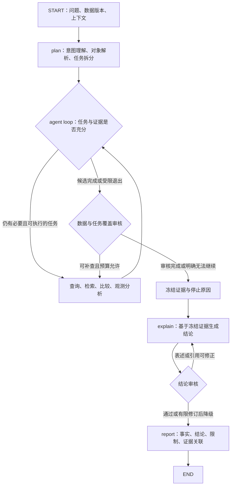

# AH-028～AH-031：秒内观测、跨小区意图与专家循环修订方案

记录日期：2026-11-12（Asia/Shanghai）。证据来自 2026-11-11 本地试用及 2026-11-12 代码复核。

状态：问题记录与拟议实施方案；本次未修改分析代码，未执行修复后的验收，未创建在线 Issue。本方案尚未替换当前 expert.v1 实现。

## 1. 已确认的问题与证据

### AH-028 / P0：秒级时间合并导致变化丢失、小区曲线消失

现场动作 `febec7e9-f1a3-4563-b016-fcfafd17ce98`，数据版本 `4170aba8-d462-4d24-a2d1-e35ceaf3d826`，问题“这份数据中的TA变化情况怎么样”。与此前日期跨多天的版本不同，本版本全部观测日期时间为 `2026/10/11 10:11:21`。

| 对象 | 原始行数 | TA 原始值及条数 | 当前时序结果 |
| --- | ---: | --- | --- |
| 小区 1 | 49 | 18：23条；74：16条；32767：1条；20：9条 | 1 个合并点，value=NULL，0 个有效点 |
| 小区 2 | 48 | 16：48条 | 1 个合并点，value=16 |

小区 1 前四行的 frmNum 为 37、38、39、40，uwTtiCnt1 为 30272284、30272294、30272304、30272314。小区 2 的计数起点不同，不能按两小区 TTI 的绝对值直接对齐。以上频数不是变化顺序，也不证明 32767 的业务语义。

根因：`srs_helper/charts.py::metric_time_series` 按 logicCellId、ue_uid、event_ts 合并；同组有多个不同值，就将 value 置空。秒级时间相同的不同帧被错误判为同一观测位置的冲突。`app.py` 只使用 event_ts 作横轴，`chart_preview.py` 同样按该字段排序。仅修改绘图横轴无法恢复查询阶段丢失的点。

质量阻断点也按粗时间匹配，可能把一帧异常扩大到整秒。首末值、分段、降采样、摘要需同步修订；“同时间冲突”需细化为同一对象、同一可信精细观测位置的冲突。

### AH-029 / P1：图表只能选择一个小区/会话，不能联合查看同一主体

`app.py` 用单选框选择 `(logicCellId, ue_uid)`，再调用 `time_coverage`。即使查询已包含两个小区，图中也只显示一个对象。“只有一个小区”需区分：入口漏选、值被置空、展示只选一个对象。

用户需求是在同一数据集内，将明确声明属于同一物理用户的多个小区记录放在同一分析视图中观察。不等于跨数据集合并，不等于将各小区值求平均，也不改写原始 ue_uid。

### AH-030 / P0：固化意图识别与单值 Scope 静默漏选对象

2026-11-12 本地调用 `parse_question(question, Scope())` 复现：

| 问句 | 当前结果 |
| --- | --- |
| 小区1和2是同一个用户，把两个小区的TA变化放在一起看 | logic_cell_id=1，无 issues，未识别同一用户声明 |
| 小区1和小区2是同一个用户，把两个小区的TA变化放在一起看 | 多个候选，要求明确选择；无法表达明确的两小区集合 |
| 一份数据包含两个小区的跟踪，他们是同一个用户，放在一起看TA变化 | 全范围，但未识别同一用户声明 |

原因：`question_scope.py` 用正则抽取对象，`queries.py::Scope` 只有单值 logic_cell_id；多值被当成歧义。`intents.py::single_subject_candidate` 仅识别部分“多个 CRNTI…同一用户”句式。遗留界面筛选为小区 1 时，“这份数据两个小区…”还会无提示地继承单小区范围。

`confirm_request` 固定分组和图型；`agent.py::initial_plan` 主要复制问题、范围、指标，后续动态查询仍受入口 scope 约束。因此后续模型即使理解问题，也不能恢复被排除的小区。已有身份声明主要用于说明，不足以形成多对象联合视图。

### AH-031 / P1：动态工具格式失败缺乏具体诊断与有界修复

动作 `46b59bf2-cd28-4465-972e-c7cc72a4e4e2` 已生成有效 TA 统计，工具循环两次搜索 taValue/32767 语义后，台账仅留下 `ValidationError`，整体 TECHNICAL_FAILURE，跳过解释。此动作使用日期跨多天的旧样例版本，不能与 AH-028 混作同一次验证。

`expert_tools.py::run_tools` 只保存异常类名或 code，缺少校验位置和可修复原因。目前无法由持久化记录确定具体失败参数，不能猜测为某个 schema 错误。数据已取得、任务覆盖程度、模型调用失败应分别展示。

32767 的业务合法性待可信字段规则说明。缺规则可报告原始观测及限制，不擅自剔除或换算距离；只做原始值趋势时不应为此无限搜索。

## 2. 架构建议

用户提出“意图识别 → 任务拆分 → 完成判断/执行循环 → 数据审核 → 结论生成 → 结论审核 → 报告”的方向合理。可靠性取决于任务语义、对象集合和证据审核契约，不能仅靠增加节点。



可以保留顶层 `START → plan → agent loop → explain → report → END`：数据审核为 loop 出口门禁，结论审核为 explain 输出门禁。需要独立重试/计时时可展开为子图或显式节点，先明确职责和状态再确定节点数。

数据审核必须在证据冻结前：发现遗漏小区、粒度不够等可补查项时继续 loop，不能先认定已闭环再审核。冻结后不再查数据；结论审核只修正既有证据上的表达、引用及结论强度，不返回 agent loop。证据不足则降级并列出缺口，后续新分析动作携带问题与证据继续，符合此前 explain 单向输出要求。

## 3. 意图、范围、主体与展示分别建模

### 3.1 LLM 理解语义，代码校验执行边界

模型读取原问题、明确的上下文、数据集摘要、有界对象清单或对象检索结果、字段目录和知识语义，生成结构化 IntentSpec：目标、对象选择表达式、指标、比较/联合观察方式、身份声明、时间粒度、完成标准、待澄清项及依据的原句片段。

“趋势/比较/原因”等作为可组合能力标签，不作为封闭问题分类。字段解析结合当前 schema 和知识资产，不只支持 question_fields.json 的少数问法，也不允许凭空创造字段。正则可保留为候选提示，不能单独决定整个分析范围。保存任务依据和可核验证据，不要求输出模型内部思考链。

区分用户明确要求、界面显式硬约束、历史上下文和子任务局部范围。明确的两个小区不是歧义，子任务查一个小区不能改变全局范围。显式硬约束与问题冲突时只澄清必要项；无冲突的多选直接执行，不增加例行确认。

### 3.2 多对象范围与身份声明

范围采用规范化选择表达式支持 IN、AND、OR，编译为参数化 SQL。查询、预检、质量统计、回查、范围哈希与重试共用实现。

“小区1的CRNTI 100与小区2的CRNTI 200”应是 `(cell=1 AND crnti=100) OR (cell=2 AND crnti=200)`，不能用两个独立 IN 产生额外配对。保留旧单值 Scope 的兼容转换，避免各模块自行拼条件。

主体关联使用本次用户声明，绑定数据版本、选择范围、具体成员和原句；联合视图保留小区/CRNTI/会话/资源来源，不改基础身份。若每小区有多个用户且未明确成员，才需进一步消歧；不得直接把所有 UE 合为一人。

“这份数据里的两个小区”先通过轻量对象查询定位实际成员；存在多于两个且指代不明时再问。追问以原问题、补充问题、父证据和新的语义请求进入流程，明确继承或修订哪些范围/身份说明，不能无条件锁死在旧单小区筛选上。不同数据集仍分开分析。

示例语义结果（设计示意，不是现有可执行 schema）：

```json
{
  "selection": {"logic_cell_ids": [1, 2]},
  "subject_relation": "same_physical_user",
  "subject_basis": "user_statement",
  "metrics": ["taValue"],
  "goals": ["覆盖两个小区", "保留秒内TA变化", "联合观察并说明差异与限制"],
  "view": {"mode": "joint", "series_by": ["logicCellId", "ue_uid"], "connect_across_segments": false}
}
```

### 3.3 任务覆盖决定退出

本例任务：核对成员及各小区记录数 → 核对 TA/时间精度 → 提取精细观测 → 检查异常和对齐能力 → 联合展示与变化说明。单位、哨兵值不明时输出原始值事实与限制，物理含义/根因需要额外规则。

任务包含目标、依赖、对象集合、证据、验收条件、状态、失败原因。查询成功、非空结果、模型说 finish 都不代表完成。审核对照“要求的对象集合”和“实际证据集合”，逐小区核对原始、业务有效、可定位、可绘图、冲突、缺失记录数，漏查则补查，确实无数据须有查询证据。

出口区分已验证完成、数据/规则受限、待消歧、技术失败、预算耗尽、无新进展。每个必要目标必须有结果或明确阻碍；设累计预算、查询去重和有限修复，不能无限循环，也不能静默丢弃目标。

## 4. 秒内时间轴及联合图

1. 公共观测层保留 event_ts、原始时间精度、uwTtiCnt1、frmNum、subFrmNum、slot/slot_in_frame、资源与原始文件/行号。流控块仍仅按单文件原始顺序划分，不受展示排序影响。
2. 精细观测键包含对象、时间锚点、可信无线时序字段与必要资源维度。帧/TTI 会重复、回绕或重置，不能裸用作全局唯一键；record_id 只保证回查，不证明先后。
3. 使用语义/计数范围已确认且与原始顺序一致的序列恢复帧内/帧间顺序。回绕、重置、乱序、字段缺失及跨文件重叠分别识别；无法确定则分段、标记顺序未知，不猜回绕次数、不跨不明边界连线。日期用于跨零点锚定。
4. 同秒不同可信帧/时隙保留独立点；仅同对象、同资源口径和同精细位置的不一致值判冲突。不同资源分别展示或按明确口径统计，定位不明的行保留明细，不强行合并。
5. 有可信锚点、计数单位和配置时用精细时间轴；否则用“帧/时隙观测序列”轴，注明非真实时间间隔，悬停展示原字段。不能把序号当毫秒，不能简单将帧内偏移加到整秒上冒充精确时间。
6. 联合视图默认包含主体成员，颜色区分小区，资源/会话可分面并允许开关。跨小区共轴需可信同步依据；计数/帧基准不明时并排展示各自序列，明确不能据此判断严格同时发生或切换时刻，不把各自首点硬对齐。
7. 质量阻断、缺口、分段、首末值、极值、变化计数、降采样与模型摘要共用定位规则。分别报告原始行数、独立观测数、有效点数及减少原因，避免把聚合空点解释成原始数据缺失。

涉及当前详设会话/观测语义、3.6.2 和 6.6。会话 180 秒阈值不随本次画图修复自动改变；更细时间对边界的影响单独验证。

## 5. 审核与错误恢复

数据审核由代码检查范围集合、计数、精度、查询参数、分母、质量口径、完整性和覆盖；LLM 辅助发现语义任务漏项。不能只让同一模型再读一次自己的答案就视为验证。

结论审核检查数值/单位引用、用户声明来源、相关与因果、受限状态及对象覆盖。允许有限次数按错误反馈重写，只用冻结证据；仍失败则输出已核验事实与未完成说明。

工具校验失败保存错误类型、字段位置、安全摘要、关联任务、尝试次数。格式问题有界修复并提供 schema 与错误位置，真实缺字段/越界不能盲目重试。不要将原始模型输入或敏感配置写入用户错误提示。搜索应给出有版本/出处的相关内容，路径命中不等于业务规则已确认。

## 6. 实施顺序与模块

| 阶段 | 改动 | 主要模块及完成标准 |
| --- | --- | --- |
| P0-A | 多对象范围与覆盖预检 | question_scope/intents/queries/app；明确多选不再静默漏选 |
| P0-B | 公共观测定位与同秒冲突修复 | 新观测层、charts/chart_preview/result_summary；小区1不再仅因同秒全部置空 |
| P1-A | 多小区联合视图 | app/canvas/chart_preview；保留对象来源及轴的真实含义 |
| P1-B | LLM 结构化意图与任务计划 | plan/agent/question_scope；规则作为校验，低置信且影响范围时精准澄清 |
| P1-C | 数据出口审核与结论审核 | agent/expert_tools/analysis_bundle；冻结前补查，冻结后有限修订，保存失败详情 |
| P2 | 回归、追问恢复和现场验收 | 请求/范围/排序版本绑定证据；通过后同步现行设计与实现覆盖 |

不原地改写历史数据和证据。查询/绘图变化可基于旧数据生成新动作；新增标准化字段或清洗语义时由固定快照重载。新的 Scope、IntentSpec、排序版本进入请求哈希、摘要、缓存及恢复状态，旧报告按旧 schema 读取。

## 7. 验收清单（待实施）

- 同秒多帧不同值保留变化，恒定值也保留独立观测；同一精细位置真冲突断线，异常不污染整秒。49/48 行不盲目要求等于点数，需核验完整观测键及重复情况。
- 帧回绕、计数重置、乱序、缺字段、多天相同帧、跨文件重复/重叠、资源并发不制造时间或覆盖原行。
- “小区1和2”“小区1和小区2”“这两个小区”“所有小区”“只看小区1”“先看1再对比2”“不要比较两个小区”以及遗留界面筛选，验证完整范围和任务。
- 用户声明跨小区/CRNTI 同一主体能绑定成员；疑问/假设不视为事实，对象配对不产生笛卡尔积，追问可明确修订范围。
- 某小区无数据、日期失败、全异常、全冲突时分别提示，不能只展示剩余对象后声称已完整回答。
- 无跨小区同步依据仍能联合查看，但不伪造同步轨迹、不平均成单条用户曲线。
- 数据审核发现可补查缺口回到冻结前循环；冻结后结论审核不调数据工具，重写有上限。
- schema 失败记录具体位置与次数；技术故障、预算和数据/规则缺失分别显示，32767 未确认时不擅自处理。
- 旧动作恢复、新请求哈希、摘要/预览、来源回查和无模型的明确降级路径通过定向测试。

使用同一组真实问句对比范围完整率、任务覆盖、数值正确性、无依据结论比例、澄清次数、耗时与调用成本。回归和现场确认前，不宣称诊断可靠性已经提高。
